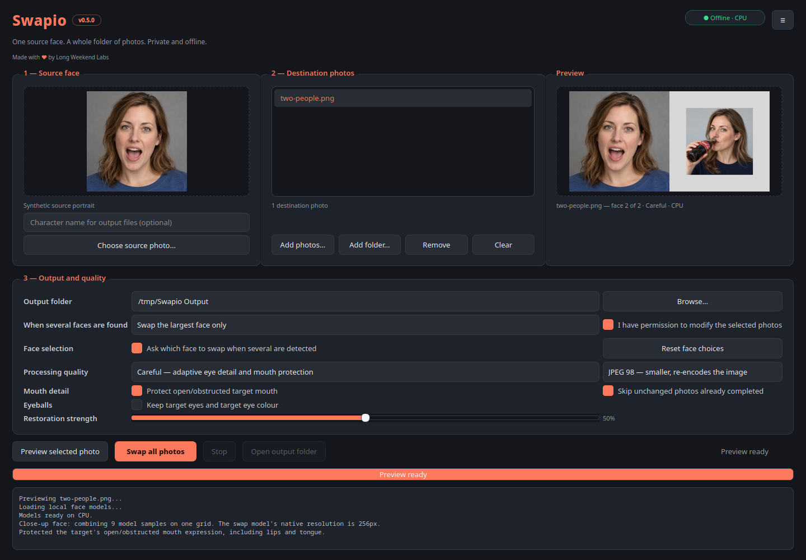
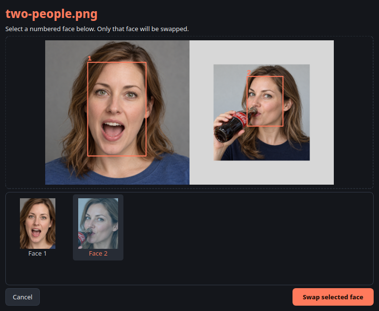
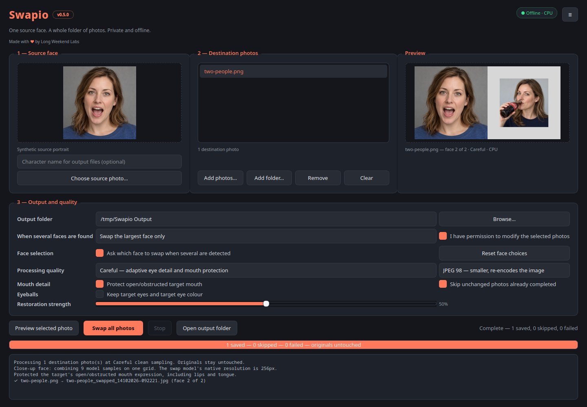

# Swapio

**Offline batch face swapping for still photos.**

Pick one source portrait, point Swapio at a folder of destination photos, and it swaps that face into every one of them. Nothing is uploaded and nothing is sent to a cloud service: after the one-time model download, the app does not use the network at all.

Swapio is free.

### [Download the latest release](https://github.com/longweekendlabs/swapio/releases/latest)

## One face in, a whole folder out

One source portrait per run. Feed it individual photos or a whole folder tree and preview the result before you commit. Swap the largest face, every detected face, or enable "Ask which face to swap when several are detected" to choose a person from numbered thumbnails. Single-face photos continue automatically; you can skip a photo or stop the batch while choosing.

Repeat a batch and it processes only new or changed photos by default. A photo that fails is skipped and reported at the end rather than killing the run, so a bad file in the middle of two hundred does not cost you the batch.

## Four quality modes, and they mean something

Careful is the default. It adjusts sampling to the face size and recovers eye detail only when its checks find lost detail and stable eyelid geometry. Tilted heads are checked in an upright crop. The restoration slider limits how much detail is added.

Best adds whole-face restoration, which can also change eyes and lips. Balanced uses fewer samples, and Fast is available for drafts. These modes cannot guarantee an exact likeness or recover every detail in a close-up.

On an NVIDIA machine, detection, drafts and face restoration can use CUDA. Quality swaps run on CPU for stability, and restoration falls back to CPU when necessary.

## What it preserves

Swapio changes facial identity and leaves everything else alone: the destination pose, expression, body, skin, hair, and image dimensions all stay. Lossless PNG output keeps every pixel outside the face composite exactly as it was decoded.

Mouth protection keeps the target's open or obstructed expression together, including lips, teeth and tongue. Closed, unobstructed lips stay generated. Foreground protection helps retain objects and hair crossing the face.

Target-eye preservation is off by default. Enabling it copies the target's eye interiors and eye colour into the swapped face. Leaving it off uses generated eyes, whose colour is not guaranteed to match the source exactly. Oriented pixels and safe EXIF and ICC metadata are retained where possible. Original files are never modified.

## Download

RPM, DEB and AppImage, for Linux on x86_64 and arm64. Grab one from the [latest release](https://github.com/longweekendlabs/swapio/releases/latest).

The package carries no face models and no CUDA libraries. On first launch Swapio lists the models it needs, downloads them from their original publishers, verifies each checksum, and then never touches the network again. On an NVIDIA machine it uses the CUDA you already have; without one it runs on CPU.

## Formats and naming

Reads `jpg`, `jpeg`, `png`, `webp`, `bmp`, `tif`, and `tiff`. Writes JPEG at quality 98 by default, with lossless PNG available.

Give a run a character name and outputs are named `CharacterName_swapped_DDMMYYYY-HHMMSS.ext`, so a batch stays recognizable months later. Without one, Swapio uses the destination filename.

## Licensing and consent

**Only alter photos you own or have permission to modify.**

The application code and the pretrained models carry different licences. InsightFace states that its downloaded pretrained models are for non-commercial research use, and HyperSwap is published under ResearchRAIL. Review those terms before use; commercial use may require separate permission. Setup keeps models out of git and requires an explicit acknowledgement before it installs anything.

## Scope

Still images only. Video, body reshaping, and character libraries are outside this release. Appearance recolouring was removed after the models evaluated for it failed the quality bar.

## Feedback

[Open an issue](https://github.com/longweekendlabs/swapio/issues) for a bug or a request.

## License

MIT, for Swapio's own code. See [LICENSE](LICENSE). The pretrained models and the libraries bundled in the packages carry their own separate terms, described in [THIRD_PARTY_NOTICES](THIRD_PARTY_NOTICES.md).

© 2026 Long Weekend Labs

---

Made with ♥ by **[Long Weekend Labs](https://github.com/longweekendlabs)**
