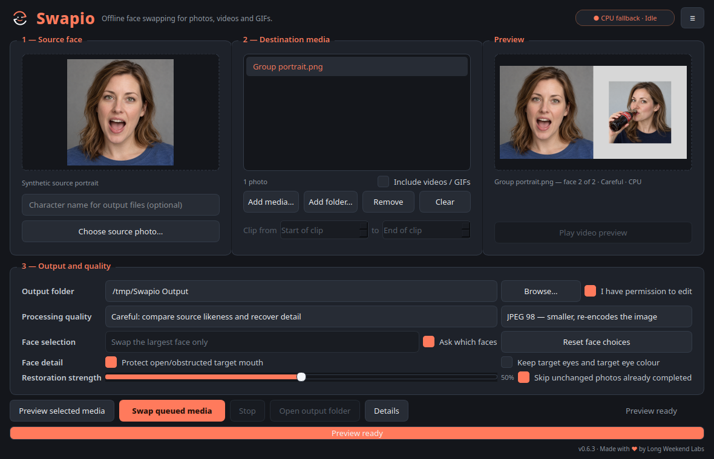
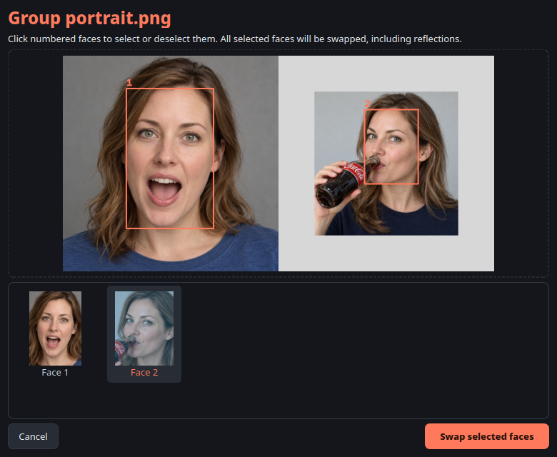
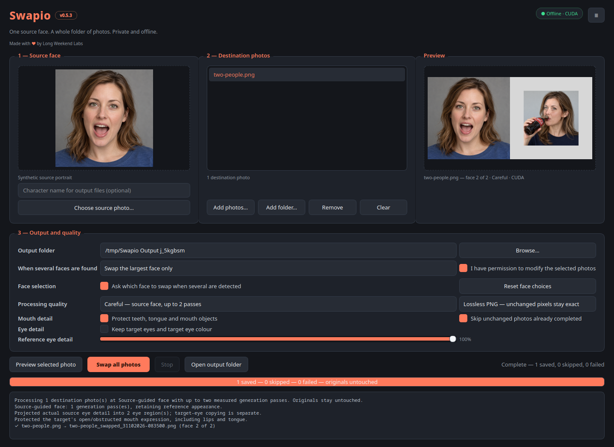

# Swapio

**Offline face swapping for photos, videos and GIFs.**

Pick one source portrait, add destination photos, short videos and GIFs, and swap that face through the queue. Nothing is uploaded and nothing is sent to a cloud service: after the one-time model download, the app does not use the network at all.

Swapio is free.

### [Download the latest release](https://github.com/longweekendlabs/swapio/releases/latest)

## One face in, a whole folder out

One source portrait per run. Use Add media for individual files or add a whole folder tree, then preview before rendering. Photos, videos and GIFs share one three-step workflow: source, destination media, output and quality. Swap the largest face, every detected face, or enable "Ask which faces" to select one or more numbered thumbnails in each photo. Click faces to toggle them, including mirror reflections, then swap only the selected faces. Single-face photos continue automatically; you can skip a photo or stop the batch while choosing.

Repeat a batch and it processes only new or changed photos by default. A failed photo does not stop the rest of the run. The final warning separates saved, skipped and failed photos and includes the actual errors; failed photos have no new output. Successful saves show their full paths in the log.

## Choose a clear source portrait

Use one sharp, evenly lit portrait with the face forward or slightly turned, both eyes visible, and a neutral expression or gentle smile. Let the face occupy a substantial part of the image. A face a few hundred pixels across is a useful starting point; Swapio does not impose a minimum source-face pixel size or require a 4K file.

If the source photo contains several people, Swapio uses the largest detected face. Blur, heavy filters, harsh shadows, extreme angles and exaggerated expressions can affect likeness even in a large file. Changing the source portrait can change the results substantially; higher resolution alone does not guarantee a better swap.

## Four quality modes, and they mean something

Careful is the default. For smaller faces, it compares two replacements against your source portrait and chooses the closer match when the difference is clear. When their likeness is similar, it keeps the more detailed rendering. Larger faces keep the detail model to protect close-up eye detail. Sampling adjusts to the face size.

Stronger replacements receive limited detail restoration, checked again against the source to avoid repainting the identity. The detailed rendering retains local eye recovery with stable eyelid geometry; tilted heads are checked in an upright crop. The restoration slider limits both kinds of recovery, and setting it to zero disables them.

Best adds whole-face restoration, which can also change eyes and lips. Balanced uses fewer samples, and Fast is available for drafts. These modes cannot guarantee an exact likeness or recover every detail in a close-up.

On an NVIDIA machine, detection, both face models and face restoration can use CUDA. Conservative workspace settings leave room for the models to run together. If identity swapping runs out of GPU memory, Swapio retries the same selected face on CPU and keeps that recovered session for later photos. Detail swapping and restoration also have checked CPU fallbacks. The log reports these changes.

After each preview or batch, Swapio unloads its processing models to free memory for other apps. Your preview stays available. The next job reloads the models automatically, adding a short startup delay. The device indicator shows CUDA enabled or CPU while idle, the actual device during processing, and CPU fallback when needed.

## What it preserves

Swapio replaces facial features within the destination photo. The body, hair, background and image dimensions stay. The models aim to retain pose and expression, but can change eyebrows, eyelids and lips. Lossless PNG output keeps every pixel outside the face composite exactly as it was decoded.

Mouth protection keeps the target's open or obstructed expression together, including lips, teeth and tongue. Closed, unobstructed lips stay generated. Foreground protection helps retain objects and hair crossing the face.

Target-eye preservation is off by default. Enabling it keeps the target's eye interiors, eyelids, lashes and eye colour in the swapped face. Leaving it off uses generated eyes, whose colour is not guaranteed to match the source exactly. Oriented pixels and safe EXIF and ICC metadata are retained where possible. Original files are never modified.

## Preview an animation before rendering it

Tick Include videos / GIFs to process clips and GIF animations in the same queue as photos. When included clips are present, quality switches to Careful and stays locked; unticking restores your photo quality choice. The same source portrait, eye, mouth and restoration controls apply.

Select a video or GIF to adjust its own optional start and end directly below the queue. Leave Start of clip / End of clip for the full clip. These controls stay greyed out for photos and while videos/GIFs are excluded. Enabling included clips shows one combined notice explaining that clips follow one face each, with warnings for durations over one and three minutes. Excluded clips do not trigger these notices. Preview selected media confirms that animation processing takes time, then generates up to two seconds for playback in your usual video player. Choose the person to follow when prompted; multiple-person clips always require one explicit face choice. Selecting several faces is available for photos only.

Tracking checks the selected person's original face identity on every frame. Uncertain matches stay unchanged and are counted in the result. The face model and sampling choice stay fixed within each continuous scene to reduce flicker; blinking, speech, occlusion and cuts still need visual review.

Videos export MP4 with the original audio content and displayed orientation. Variable-frame-rate inputs are converted to their average frame rate. Media runs sequentially, photo and animation model sets unload before switching between them and after the job, and cancelled or failed renders remove temporary movies. Only verified outputs count as saved.

GIF input stays GIF output, keeping the frame delays, loop count, dimensions and transparency. Zero or missing frame delays use 100 milliseconds. Each frame uses GIF's limited colour palette; colours may change during export. Frames are processed one at a time, without keeping the whole animation in memory. GIF processing uses the existing image libraries and needs no FFmpeg.

Video requires the computer's FFmpeg and ffprobe, with H.264 encoding available. Swapio reports missing tools and does not download another media runtime. HDR inputs need an SDR copy for this first video version. This feature is available for local testing and has not been released in the downloadable packages yet.

## Download

RPM, DEB and AppImage, for Linux on x86_64 and arm64. Grab one from the [latest release](https://github.com/longweekendlabs/swapio/releases/latest).

The package carries no face models and no CUDA libraries. On first launch Swapio lists the models it needs, downloads them from their original publishers, verifies each checksum, and then never touches the network again. On an NVIDIA machine it uses the CUDA you already have; without one it runs on CPU.

Installed models live in your user data folder. The installed app runs independently of the source code and development environment.

## Formats and naming

Reads photos in `jpg`, `jpeg`, `png`, `webp`, `bmp`, `tif`, and `tiff`, and videos in `mp4`, `mov`, `mkv`, `webm`, `avi`, and `m4v`, plus `gif` animations. Photo output defaults to JPEG at quality 98, with lossless PNG available; video output is MP4 and GIF output is GIF.

Give a run a character name and outputs are named `CharacterName_swapped_DDMMYYYY-HHMMSS.ext`, so a batch stays recognizable months later. Without one, Swapio uses the destination filename.

## Licensing and consent

**Only alter photos you own or have permission to modify.**

The application code and the pretrained models carry different licences. InsightFace states that its downloaded pretrained models are for non-commercial research use, and HyperSwap is published under ResearchRAIL. Review those terms before use; commercial use may require separate permission. Setup keeps models out of git and requires an explicit acknowledgement before it installs anything.

## Scope

Photo swapping and experimental short-video/GIF swapping. Body reshaping and character libraries remain outside the app. Appearance recolouring was removed after the models evaluated for it failed the quality bar.

## Feedback

[Open an issue](https://github.com/longweekendlabs/swapio/issues) for a bug or a request.

## License

MIT, for Swapio's own code. See [LICENSE](LICENSE). The pretrained models and the libraries bundled in the packages carry their own separate terms, described in [THIRD_PARTY_NOTICES](THIRD_PARTY_NOTICES.md).

© 2026 Long Weekend Labs

---

Made with ♥ by **[Long Weekend Labs](https://github.com/longweekendlabs)**
